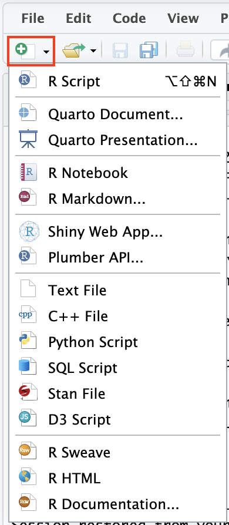
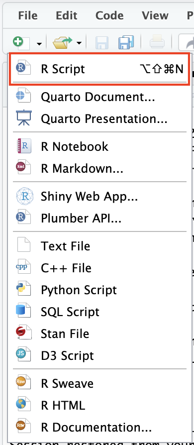
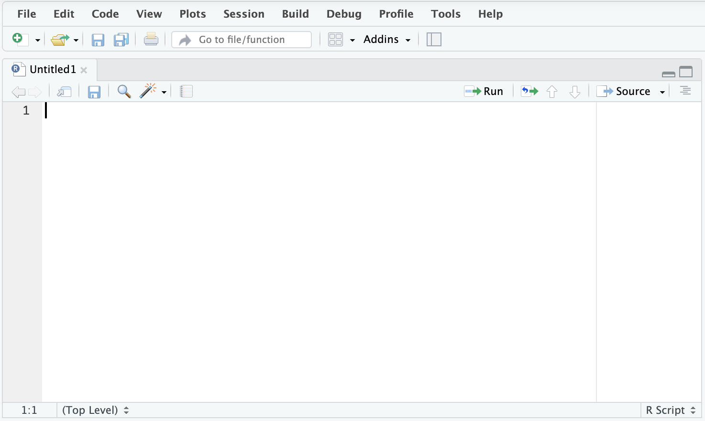
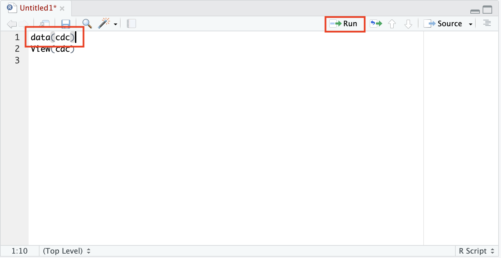
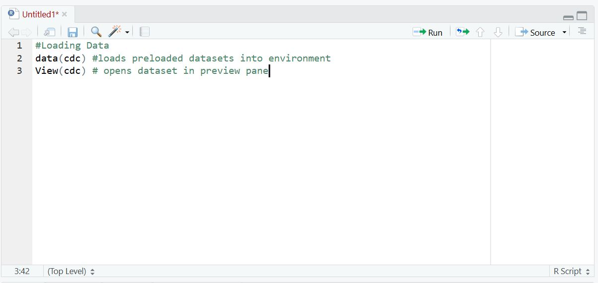

```{r setup, include=FALSE}
# Show the code on every slide, but don't run it.
# Students run the code themselves to see the output.
knitr::opts_chunk$set(echo = TRUE, eval = FALSE)
```

## RScripts

An **R Script** is a text file where you can write and run code. R Scripts are saved in your **Files** tab, so you can come back to your code later.

<font color="#25679E">Create a new R Script in your RStudio project:</font>

- <font color="#25679E">a) Click on the green plus in the top left corner of the project.</font>
- <font color="#25679E">b) Select **R Script** from the list of options for new files.</font>

{width=25%} &nbsp;&nbsp;&nbsp; {width=25%}

## Your First R Script

There is now a new R Script in the Preview pane! This is where you will type and run your code.

{width=60%}

## Running Code in an R Script

<font color="#25679E">Load and view the CDC data by typing the following commands into your R Script:</font>

```{r}
data(cdc)
View(cdc)
```

<font color="#25679E">To run the first line of code, place your cursor at the end of the line and click **Run**.</font> When you run code in an R Script, the output shows up in the console pane below it.

{width=60%}

## Looking at the Environment

Look at your **Environment** pane.

- <font color="red"> **1) Describe what you see in the Environment pane.**</font>
- <font color="red"> **2) Describe how the data are displayed.**</font>

## Comments

Comments are an excellent way for you to write notes and describe your code for your future self without running into errors. To write comments, type a "#" before your comment. Here is an example:

{width=80%}


<font color="#25679E"> Write a few comments to yourself in your RScript. </font>

## Arithmetic Operations Challenge
<font color="#25679E">
Did you know that you can use `R` as a calculator? In your RScript, try to figure out how to do the following: 

1) Add 5 and 7

2) Subtract 61 from 52

3) Multiply 4 and 9

4) Divide 51 by 17</font>


## Arithmetic Operations Reveal
Here's how you would do those arithmetic operations in `R`: 
```{r}
#1 Add 5 and 7
5+7
#2 Subtract 61 from 52
52-61
#3 Multiply 4 and 9
4*9
#4 Divide 51 by 17
51/17
```

## Division Challenge
<font color="#25679E"> Try running the following. </font> 

<font color="red"> **3) How are the two outputs different?** </font>
```{r}
#Option 1
10/3
#Option 2
10%/%3 
```
<font color="red"> **4) What do you think the output would be for `11%/%3` ?** </font>

Try it. Were you correct?

## Advanced Operations Challenge
<font color="#25679E"> Try to figure out how to evaluate the following:

1) 2 to the power of 3

2) Square root of 144

3) Natural log of 2.71828

4) *e* to the power of 1 (Hint: *e* is the base of an exponential function) </font>


## Advanced Operations Reveal
```{r}
#1 2 to the power of 3
#Two ways to do exponents:
2^3
2**3
#2 Square root of 144
sqrt(144)
#3 Natural log of 2.71828
log(2.71828)
#4 *e* to the power of 1 
exp(1)
```

## Assignment Operator and Storing Values

You can store values in your environment using the '<-' symbol. 

<font color="#25679E"> Run these codes and look in your environment: </font>
```{r}
A<-5+2
A
```
You can give any value or string any name, but good names are **short and descriptive**.

``` {r} 
alice<-2
bob<-5
carol<-3
```
Once you've stored a numerical value using a name, you can perform operations with those names:
```{r}
alice+bob
bob-carol
(alice+carol)/bob
```
## Order of Operations

<font color="#25679E"> Try evaluating the quadratic formula using the algebraic variables, a,b, and c. </font>
```{r}
a<-2
b<-5
c<-3
```
Notice you need to remember order of operations, so use parentheses!
```{r}
(-b+sqrt(b^2-4*a*c))/(2*a) 
```
Remember you can store values using `<-` Let's find the discriminant of this quadratic function.

``` {r}
disc<-(b^2-4*a*c)

(-b+sqrt(disc))/(2*a)
(-b-sqrt(disc))/(2*a)
```


## Logical Operators Challenge
<font color="red"> **5) Before you run each of the following codes, predict whether each line will be `TRUE` or `FALSE`.** </font>
```{r}
3==3
3<2
5<=7
5<=5
8>=1
```

For the following, we will assign the value 3 the name "a" :
```{r}
a<-3
3==a
3!=a
```

## Logical Operators

You just used logical operators! Logical operators let you ask R a yes-or-no question about two values. Instead of giving you a number, R answers with `TRUE` or `FALSE`.

| Operator | Question it asks             |
|:--------:|------------------------------|
| `<`      | Is the left side less than the right? |
| `>`      | Is the left side greater than the right? |
| `<=`     | Is it less than **or equal to**? |
| `>=`     | Is it greater than **or equal to**? |
| `==`     | Are the two sides equal? |
| `!=`     | Are the two sides **not** equal? |

Be careful: to check if two things are equal, use **two** equal signs (`==`). A single `=` (like `<-`) *stores* a value instead of comparing.

## Extra Challenges
- Recall that evaluating `log(2.71828)` gave you 0.9999993, since 2.71828 is only an approximation of *e*.

- Using what we have done so far, can you find a way to find the exact natural log of *e*? Consider what the actual natural log of *e* is.

## Extra Challenges Reveal
```{r}
log(exp(1))
log(2.718282) #Notice one more place value of e gave us 1.
```
